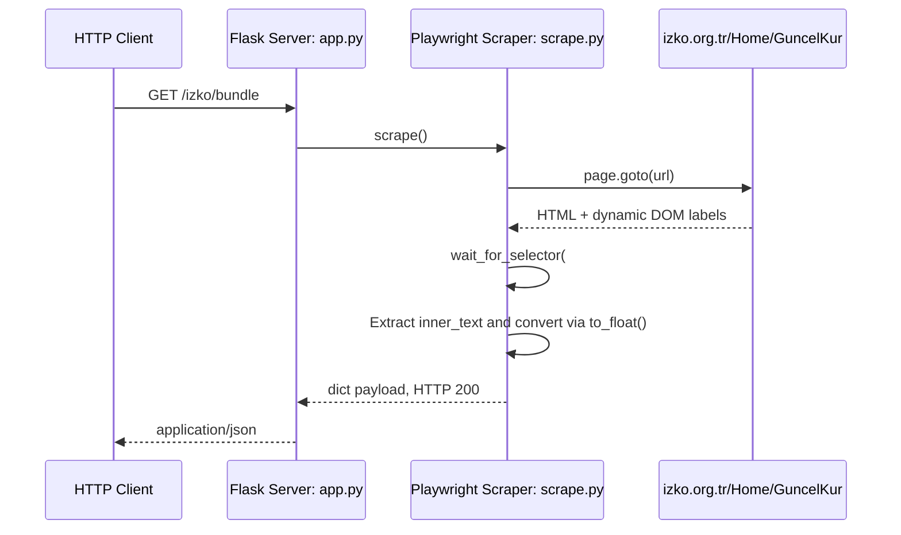

<!-- well-document · audit scorecard: G1:5 G2:5 G3:5 G4:5 G5:5 G6:5 · STATUS: PASS -->

# izko-gold-price-api

[](https://github.com/AtaCanYmc/izko-gold-price-api/actions/workflows/ci.yml)
[](https://www.python.org/downloads/)
[](LICENSE)

Flask REST API that scrapes live gold and currency rates from the Izmir Jewelers Chamber (`izko.org.tr`) using headless Chromium via Playwright.

## Table of Contents

- [System Architecture](#system-architecture)
- [Quick Start: Docker](#quick-start-docker)
- [Manual Local Setup](#manual-local-setup)
- [API Endpoints](#api-endpoints)
- [Configuration](#configuration)
- [Repository Layout](#repository-layout)
- [Testing and Verification](#testing-and-verification)
- [Contributing and Security](#contributing-and-security)
- [License](#license)

## System Architecture

The service exposes two HTTP GET routes through Flask. When `/izko/bundle` is requested, `scrape.py` launches a headless Chromium instance through Playwright, waits for the price table DOM selector `#ataLabel` to populate on `https://www.izko.org.tr/Home/GuncelKur`, extracts each configured element ID, and normalizes Turkish formatted decimals into IEEE 754 floating-point numbers.



## Quick Start: Docker

Run the service in an isolated container with Chromium and system libraries pre-installed.

```bash
# 1. Clone the repository
git clone https://github.com/AtaCanYmc/izko-gold-price-api.git && cd izko-gold-price-api

# 2. Bind Flask to all container interfaces in config.json
python3 -c 'import json; p="config.json"; c=json.load(open(p)); c["api"]["host"]="0.0.0.0"; json.dump(c, open(p,"w"), indent=2)'

# 3. Build and start the container
docker build -t izko-gold-price-api .
docker run -d -p 5000:5000 --name izko-api izko-gold-price-api

# 4. Verify service metadata endpoint
curl -f http://localhost:5000/izko
```

## Manual Local Setup

Run the service directly on macOS, Linux, or Windows with Python 3.10 or newer.

```bash
# 1. Create and activate a virtual environment
python3 -m venv venv
source venv/bin/activate

# 2. Install Python dependencies and Chromium binary
pip install -r requirements.txt
playwright install chromium

# 3. Start the Flask development server
python app.py
```

## API Endpoints

### `GET /izko`

Returns the active server configuration and registered route paths from [`config.json`](config.json).

```bash
curl -s http://127.0.0.1:5000/izko
```

Response (`200 OK`):

```json
{
  "debug": true,
  "endpointList": {
    "base": "/izko",
    "bundle": "/izko/bundle"
  },
  "host": "127.0.0.1",
  "port": 5000,
  "rootMessage": "Welcome to izko API"
}
```

### `GET /izko/bundle`

Executes a live headless Chromium scrape against the configured IZKO URL and returns parsed quotes. Numeric strings with Turkish thousand separators `.` and decimal commas `,` are converted to floats. Non-numeric values such as the timestamp string remain strings.

```bash
curl -s http://127.0.0.1:5000/izko/bundle
```

Response (`200 OK`):

```json
{
  "priceList": {
    "14Ayar": 2150.0,
    "18Ayar": 2580.0,
    "22Ayar": 3180.0,
    "Ceyrek": 5720.0,
    "Cumhuriyet": 23450.0,
    "Dolar": 34.25,
    "Euro": 37.1,
    "GramAltin": 3180.0,
    "PaketliHas": 3505.0,
    "Tarih": "14:30:00",
    "Yarim": 11440.0,
    "Ziynet": 22880.0
  },
  "url": "https://www.izko.org.tr/Home/GuncelKur"
}
```

## Configuration

All runtime settings live in [`config.json`](config.json).

### Server and Scraper Parameters

| Key Path | Type | Default | Required | Description |
| :--- | :--- | :--- | :---: | :--- |
| `url.izko` | String | `https://www.izko.org.tr/Home/GuncelKur` | Yes | Target URL scraped by Playwright. |
| `url.timeout` | Integer | `10000` | Yes | Selector wait timeout in milliseconds. |
| `api.host` | String | `127.0.0.1` | Yes | Flask bind address. Set to `0.0.0.0` inside Docker containers. |
| `api.port` | Integer | `5000` | Yes | HTTP listener port. |
| `api.debug` | Boolean | `true` | Yes | Enables Flask debug reloader. Set to `false` in production. |
| `api.rootMessage` | String | `Welcome to izko API` | No | Informational message returned by `/izko`. |

### DOM Selector Mapping (`label`)

| Output Field | Target DOM ID | Asset Type |
| :--- | :--- | :--- |
| `22Ayar` | `#yirmiikiLabel` | 22 Karat gold price |
| `18Ayar` | `#onsekizLabel` | 18 Karat gold price |
| `14Ayar` | `#ondortLabel` | 14 Karat gold price |
| `GramAltin` | `#gramLabel` | 24 Karat gram gold price |
| `Cumhuriyet` | `#ataLabel` | Cumhuriyet gold coin price and readiness anchor |
| `Ceyrek` | `#yeniceyrekLabel` | Quarter gold coin price |
| `Yarim` | `#yeniyarimLabel` | Half gold coin price |
| `Ziynet` | `#yenitamLabel` | Full Ziynet gold coin price |
| `PaketliHas` | `#ons` | Packaged fine gold / ounce indicator |
| `Dolar` | `#dolar` | USD/TRY exchange rate |
| `Euro` | `#euro` | EUR/TRY exchange rate |
| `Tarih` | `#clock` | Source update timestamp |

## Repository Layout

```text
.
├── .github/
│   ├── CODEOWNERS
│   ├── ISSUE_TEMPLATE/
│   │   ├── bug_report.yml
│   │   ├── config.yaml
│   │   └── feature_request.yml
│   ├── PULL_REQUEST_TEMPLATE/
│   │   └── pull_request_template.md
│   ├── dependabot.yml
│   └── workflows/
│       └── ci.yml
├── .editorconfig
├── .gitattributes
├── .gitignore
├── .markdownlint.json
├── CONTRIBUTING.md
├── Dockerfile
├── LICENSE
├── README.md
├── ROADMAP.md
├── SECURITY.md
├── app.py
├── config.json
├── requirements.txt
└── scrape.py
```

## Testing and Verification

Validate configuration syntax, Python bytecode compilation, and float normalization locally before opening a pull request:

```bash
# Verify Python syntax and compile bytecode
python -m py_compile app.py scrape.py

# Verify Turkish decimal normalization logic (with virtualenv active)
python -c "from scrape import to_float; assert to_float('23.450,75') == 23450.75; assert to_float('14:30') == '14:30'"
```

## Contributing and Security

- Contribution workflow and commit conventions are documented in [CONTRIBUTING.md](CONTRIBUTING.md).
- Planned technical milestones are tracked in [ROADMAP.md](ROADMAP.md).
- Vulnerability disclosure steps are specified in [SECURITY.md](SECURITY.md).

## License

Released under the [MIT License](LICENSE).
