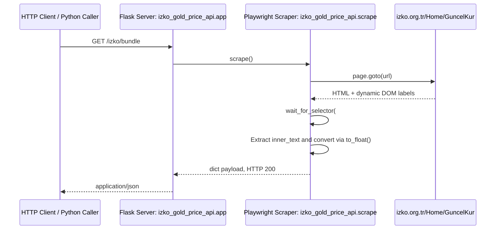

<!-- well-document · audit scorecard: G1:5 G2:5 G3:5 G4:5 G5:5 G6:5 · STATUS: PASS -->

[Türkçe Dokümantasyon](README.tr.md)

# izko-gold-price-api

[](https://github.com/AtaCanYmc/izko-gold-price-api/actions/workflows/ci.yml)
[](https://www.python.org/downloads/)
[](LICENSE)

Flask REST API and Python package that scrapes live gold and currency rates from the Izmir Jewelers Chamber (`izko.org.tr`) using headless Chromium via Playwright.

## Table of Contents

- [System Architecture](#system-architecture)
- [Installation from PyPI](#installation-from-pypi)
- [Quick Start: Docker](#quick-start-docker)
- [Manual Local Setup](#manual-local-setup)
- [Command-Line Interface](#command-line-interface)
- [Model Context Protocol Server](#model-context-protocol-server)
- [Python Library Usage](#python-library-usage)
- [API Endpoints](#api-endpoints)
- [Configuration](#configuration)
- [Building and Publishing to PyPI](#building-and-publishing-to-pypi)
- [Repository Layout](#repository-layout)
- [Testing and Verification](#testing-and-verification)
- [Contributing and Security](#contributing-and-security)
- [License](#license)

## System Architecture

The package exposes both a Python API (`izko_gold_price_api`) and a Flask server entry point (`izko-gold-price-api`). When `/izko/bundle` or `scrape()` is called, [`scrape.py`](src/izko_gold_price_api/scrape.py) launches a headless Chromium instance through Playwright, waits for the price table DOM selector `#ataLabel` to populate on `https://www.izko.org.tr/Home/GuncelKur`, extracts each configured element ID, and normalizes Turkish formatted decimals into IEEE 754 floating-point numbers.



## Installation from PyPI

Install the package and download the Playwright Chromium binary:

```bash
pip install izko-gold-price-api
playwright install chromium

# Start the Flask REST API server
izko-gold-price-api
```

## Quick Start: Docker

Run the service in an isolated container with Chromium and system libraries pre-installed.

```bash
# 1. Clone the repository
git clone https://github.com/AtaCanYmc/izko-gold-price-api.git && cd izko-gold-price-api

# 2. Build and start the container
make docker-build
make docker-run

# 3. Verify service metadata endpoint
curl -f http://localhost:5000/izko
```

## Manual Local Setup

Install the package in editable mode on macOS, Linux, or Windows with Python 3.10 or newer.

```bash
# 1. Create and activate a virtual environment
python3 -m venv venv
source venv/bin/activate

# 2. Install package in editable mode and download Chromium binary
make install

# 3. Start the Flask server via CLI entry point
make run
```

## Command-Line Interface

The `izko-gold-price-api` command and `python -m izko_gold_price_api` module entry point are implemented in [`cli.py`](src/izko_gold_price_api/cli.py) with three subcommands: `serve`, `scrape`, and `config`.

```bash
# Start Flask server on custom host and port with debug disabled
izko-gold-price-api serve --host 0.0.0.0 --port 8080 --no-debug

# Scrape live rates once and pretty-print JSON to stdout
izko-gold-price-api scrape --pretty

# Query a single price field for shell pipelines
izko-gold-price-api scrape --field GramAltin

# Print active configuration JSON
izko-gold-price-api config
```

| Subcommand / Flag | Short | Type | Default | Description |
| :--- | :---: | :--- | :--- | :--- |
| `--version` | `-V` | Flag | `false` | Print package version and exit. |
| `--config` | `-c` | Path | Bundled `config.json` | Override path to `config.json`. |
| `serve --host` | None | String | `127.0.0.1` | Override Flask bind host. |
| `serve --port` | None | Integer | `5000` | Override Flask listener port. |
| `serve --debug` / `--no-debug` | None | Boolean | `false` | Enable or disable Flask debug mode. |
| `scrape --field` | `-f` | String | None | Output a single field from `priceList`. |
| `scrape --pretty` | None | Flag | `false` | Format JSON output with 2-space indentation. |
| `scrape --url` | None | String | `url.izko` | Override target URL for a single run. |
| `scrape --timeout` | None | Integer | `10000` | Override selector wait timeout in milliseconds. |
| `config` | None | Subcommand | None | Print active configuration JSON and exit. |
| `mcp` | None | Subcommand | None | Start the MCP JSON-RPC 2.0 server over `stdio`. |

## Model Context Protocol Server

The package includes a zero-dependency Model Context Protocol (`MCP`) JSON-RPC 2.0 `stdio` server in [`mcp.py`](src/izko_gold_price_api/mcp.py). Launch it via `izko-gold-price-mcp` or `izko-gold-price-api mcp`.

```json
{
  "mcpServers": {
    "izko-gold-price": {
      "command": "izko-gold-price-mcp"
    }
  }
}
```

| MCP Capability | Name / URI | Description |
| :--- | :--- | :--- |
| Tool | `get_izko_prices` | Scrapes live IZKO gold and currency rates. Accepts optional `field` and `timeout` arguments. |
| Tool | `get_izko_config` | Returns active URL, selector timeout, DOM label IDs, and API configuration. |
| Resource | `izko://config` | Active configuration JSON document. |
| Resource | `izko://prices` | Live scraped price bundle JSON document. |

## Python Library Usage

Import `scrape`, `to_float`, or the Flask `app` instance directly in Python code:

```python
from izko_gold_price_api import scrape, to_float

payload, status_code = scrape()
if status_code == 200:
    print(payload["priceList"]["GramAltin"])
```

## API Endpoints

### `GET /izko`

Returns the active server configuration and registered route paths from [`config.json`](src/izko_gold_price_api/config.json).

```bash
curl -s http://127.0.0.1:5000/izko
```

Response (`200 OK`):

```json
{
  "debug": false,
  "endpointList": {
    "base": "/izko",
    "bundle": "/izko/bundle"
  },
  "host": "127.0.0.1",
  "port": 5000,
  "rootMessage": "Welcome to izko API"
}
```

### `GET /izko/bundle`

Executes a live headless Chromium scrape against the configured IZKO URL and returns parsed quotes. Numeric strings with Turkish thousand separators `.` and decimal commas `,` are converted to floats. Non-numeric values such as the timestamp string remain strings.

```bash
curl -s http://127.0.0.1:5000/izko/bundle
```

Response (`200 OK`):

```json
{
  "priceList": {
    "14Ayar": 2150.0,
    "18Ayar": 2580.0,
    "22Ayar": 3180.0,
    "Ceyrek": 5720.0,
    "Cumhuriyet": 23450.0,
    "Dolar": 34.25,
    "Euro": 37.1,
    "GramAltin": 3180.0,
    "PaketliHas": 3505.0,
    "Tarih": "14:30:00",
    "Yarim": 11440.0,
    "Ziynet": 22880.0
  },
  "url": "https://www.izko.org.tr/Home/GuncelKur"
}
```

## Configuration

Default runtime settings live in [`src/izko_gold_price_api/config.json`](src/izko_gold_price_api/config.json). Set the `IZKO_CONFIG_PATH` environment variable to point to an external JSON file when overriding defaults without modifying the installed package.

### Server and Scraper Parameters

| Key Path | Type | Default | Required | Description |
| :--- | :--- | :--- | :---: | :--- |
| `url.izko` | String | `https://www.izko.org.tr/Home/GuncelKur` | Yes | Target URL scraped by Playwright. |
| `url.timeout` | Integer | `10000` | Yes | Selector wait timeout in milliseconds. |
| `api.host` | String | `127.0.0.1` | Yes | Flask bind address. Set to `0.0.0.0` inside Docker containers. |
| `api.port` | Integer | `5000` | Yes | HTTP listener port. |
| `api.debug` | Boolean | `false` | Yes | Enables Flask debug reloader. Keep `false` in production. |
| `api.rootMessage` | String | `Welcome to izko API` | No | Informational message returned by `/izko`. |

### DOM Selector Mapping (`label`)

| Output Field | Target DOM ID | Asset Type |
| :--- | :--- | :--- |
| `22Ayar` | `#yirmiikiLabel` | 22 Karat gold price |
| `18Ayar` | `#onsekizLabel` | 18 Karat gold price |
| `14Ayar` | `#ondortLabel` | 14 Karat gold price |
| `GramAltin` | `#gramLabel` | 24 Karat gram gold price |
| `Cumhuriyet` | `#ataLabel` | Cumhuriyet gold coin price and readiness anchor |
| `Ceyrek` | `#yeniceyrekLabel` | Quarter gold coin price |
| `Yarim` | `#yeniyarimLabel` | Half gold coin price |
| `Ziynet` | `#yenitamLabel` | Full Ziynet gold coin price |
| `PaketliHas` | `#ons` | Packaged fine gold / ounce indicator |
| `Dolar` | `#dolar` | USD/TRY exchange rate |
| `Euro` | `#euro` | EUR/TRY exchange rate |
| `Tarih` | `#clock` | Source update timestamp |

## Building and Publishing to PyPI

Every merged [Release Please](.github/workflows/release-please.yml) pull request automatically builds `sdist` and `bdist_wheel` distributions and publishes them to PyPI using OpenID Connect (`OIDC`) Trusted Publishing (`pypa/gh-action-pypi-publish@release/v1`) under the `pypi` GitHub Actions environment.

To build and verify distributions locally:

```bash
make build
make publish
```

## Repository Layout

```text
.
├── .github/
│   ├── CODEOWNERS
│   ├── ISSUE_TEMPLATE/
│   │   ├── bug_report.yml
│   │   ├── config.yaml
│   │   └── feature_request.yml
│   ├── PULL_REQUEST_TEMPLATE/
│   │   └── pull_request_template.md
│   ├── dependabot.yml
│   └── workflows/
│       ├── ci.yml
│       └── release-please.yml
├── .dockerignore
├── .editorconfig
├── .gitattributes
├── .gitignore
├── .markdownlint.json
├── .release-please-manifest.json
├── CHANGELOG.md
├── CONTRIBUTING.md
├── Dockerfile
├── LICENSE
├── Makefile
├── README.md
├── README.tr.md
├── ROADMAP.md
├── SECURITY.md
├── docs/
│   ├── README.md
│   ├── api-reference.md
│   ├── architecture.md
│   ├── cli-and-mcp.md
│   └── deployment.md
├── pyproject.toml
├── release-please-config.json
├── requirements.txt
└── src/
    └── izko_gold_price_api/
        ├── __init__.py
        ├── __main__.py
        ├── app.py
        ├── cli.py
        ├── config.json
        ├── mcp.py
        └── scrape.py
```

## Testing and Verification

Validate configuration syntax, Python bytecode compilation, and documentation links locally before opening a pull request:

```bash
# Run syntax, config schema, and markdown link verification
make verify

# Verify Turkish decimal normalization logic (with virtualenv active)
python -c "from izko_gold_price_api import to_float; assert to_float('23.450,75') == 23450.75; assert to_float('14:30') == '14:30'"
```

## Contributing and Security

- Extended technical guides live in [docs/README.md](docs/README.md).
- Contribution workflow and commit conventions are documented in [CONTRIBUTING.md](CONTRIBUTING.md).
- Planned technical milestones are tracked in [ROADMAP.md](ROADMAP.md).
- Vulnerability disclosure steps are specified in [SECURITY.md](SECURITY.md).

## License

Released under the [MIT License](LICENSE).
