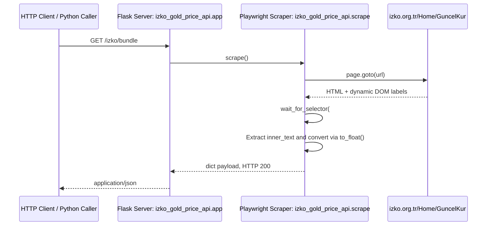

<!-- well-document · audit scorecard: G1:5 G2:5 G3:5 G4:5 G5:5 G6:5 · STATUS: PASS -->

[← Read Original in English](README.md)

# izko-gold-price-api

[](https://github.com/AtaCanYmc/izko-gold-price-api/actions/workflows/ci.yml)
[](https://www.python.org/downloads/)
[](LICENSE)

İzmir Kuyumcular Odası (`izko.org.tr`) güncel altın ve döviz kurlarını Playwright tabanlı başsız Chromium ile kazıyan Flask REST API servisi ve Python paketi.

## İçindekiler

- [Sistem Mimarisi](#sistem-mimarisi)
- [PyPI Üzerinden Kurulum](#pypi-üzerinden-kurulum)
- [Hızlı Başlangıç: Docker](#hızlı-başlangıç-docker)
- [Yerel Geliştirme Kurulumu](#yerel-geliştirme-kurulumu)
- [Komut Satırı Arayüzü](#komut-satırı-arayüzü)
- [Model Context Protocol Sunucusu](#model-context-protocol-sunucusu)
- [Python Kütüphanesi Olarak Kullanım](#python-kütüphanesi-olarak-kullanım)
- [API Uç Noktaları](#api-uç-noktaları)
- [Yapılandırma](#yapılandırma)
- [PyPI Paketi Derleme ve Yayınlama](#pypi-paketi-derleme-ve-yayınlama)
- [Dizin Yapısı](#dizin-yapısı)
- [Test ve Doğrulama](#test-ve-doğrulama)
- [Katkı ve Güvenlik](#katkı-ve-güvenlik)
- [Lisans](#lisans)

## Sistem Mimarisi

Paket hem bir Python arayüzü (`izko_gold_price_api`) hem de bir Flask sunucu komut satırı girişi (`izko-gold-price-api`) sunar. `/izko/bundle` uç noktası veya `scrape()` fonksiyonu çağrıldığında [`scrape.py`](src/izko_gold_price_api/scrape.py) Playwright üzerinden başsız Chromium başlatır, `https://www.izko.org.tr/Home/GuncelKur` sayfasındaki `#ataLabel` DOM seçicisinin yüklenmesini bekler, tanımlı tüm etiket kimliklerini okur ve Türkçe ondalık biçimindeki sayıları IEEE 754 kayan noktalı (`float`) değerlere dönüştürür.



## PyPI Üzerinden Kurulum

Paketi kurun ve Playwright Chromium tarayıcı ikilisini indirin:

```bash
pip install izko-gold-price-api
playwright install chromium

# Start the Flask REST API server
izko-gold-price-api
```

## Hızlı Başlangıç: Docker

Servisi Chromium ve sistem bağımlılıkları önceden kurulmuş yalıtılmış bir konteyner içinde çalıştırın.

```bash
# 1. Clone the repository
git clone https://github.com/AtaCanYmc/izko-gold-price-api.git && cd izko-gold-price-api

# 2. Build and start the container
make docker-build
make docker-run

# 3. Verify service metadata endpoint
curl -f http://localhost:5000/izko
```

## Yerel Geliştirme Kurulumu

Python 3.10 veya daha yeni bir sürüm ile macOS, Linux ya da Windows üzerinde paketi düzenlenebilir modda kurun.

```bash
# 1. Create and activate a virtual environment
python3 -m venv venv
source venv/bin/activate

# 2. Install package in editable mode and download Chromium binary
make install

# 3. Start the Flask server via CLI entry point
make run
```

## Komut Satırı Arayüzü

`izko-gold-price-api` komutu ve `python -m izko_gold_price_api` modül girişi [`cli.py`](src/izko_gold_price_api/cli.py) içinde üç alt komutla (`serve`, `scrape`, `config`) tanımlanmıştır.

```bash
# Start Flask server on custom host and port with debug disabled
izko-gold-price-api serve --host 0.0.0.0 --port 8080 --no-debug

# Scrape live rates once and pretty-print JSON to stdout
izko-gold-price-api scrape --pretty

# Query a single price field for shell pipelines
izko-gold-price-api scrape --field GramAltin

# Print active configuration JSON
izko-gold-price-api config
```

| Alt Komut / Bayrak | Kısa | Tip | Varsayılan | Açıklama |
| :--- | :---: | :--- | :--- | :--- |
| `--version` | `-V` | Bayrak | `false` | Paket sürümünü yazdırır ve çıkar. |
| `--config` | `-c` | Yol | Paket içi `config.json` | Özel `config.json` dosya yolunu belirler. |
| `serve --host` | Yok | String | `127.0.0.1` | Flask dinleme adresini ezer. |
| `serve --port` | Yok | Integer | `5000` | Flask dinleme portunu ezer. |
| `serve --debug` / `--no-debug` | Yok | Boolean | `false` | Flask hata ayıklama modunu açar veya kapatır. |
| `scrape --field` | `-f` | String | Yok | `priceList` içinden tek bir alanı yazdırır. |
| `scrape --pretty` | Yok | Bayrak | `false` | JSON çıktısını 2 boşluk girintiyle biçimlendirir. |
| `scrape --url` | Yok | String | `url.izko` | Tek çalıştırma için hedef URL değerini ezer. |
| `scrape --timeout` | Yok | Integer | `10000` | Seçici bekleme süresini milisaniye cinsinden ezer. |
| `config` | Yok | Alt Komut | Yok | Etkin yapılandırma JSON içeriğini yazdırır ve çıkar. |
| `mcp` | Yok | Alt Komut | Yok | `stdio` üzerinden MCP JSON-RPC 2.0 sunucusunu başlatır. |

## Model Context Protocol Sunucusu

Paket [`mcp.py`](src/izko_gold_price_api/mcp.py) içinde ek bağımlılık gerektirmeyen bir Model Context Protocol (`MCP`) JSON-RPC 2.0 `stdio` sunucusu içerir. `izko-gold-price-mcp` veya `izko-gold-price-api mcp` komutuyla başlatılır.

```json
{
  "mcpServers": {
    "izko-gold-price": {
      "command": "izko-gold-price-mcp"
    }
  }
}
```

| MCP Yeteneği | Ad / URI | Açıklama |
| :--- | :--- | :--- |
| Araç (`Tool`) | `get_izko_prices` | Canlı İZKO altın ve döviz kurlarını kazır. İsteğe bağlı `field` ve `timeout` parametrelerini alır. |
| Araç (`Tool`) | `get_izko_config` | Etkin URL, seçici zaman aşımı, DOM etiket kimlikleri ve API yapılandırmasını döndürür. |
| Kaynak (`Resource`) | `izko://config` | Etkin yapılandırma JSON belgesi. |
| Kaynak (`Resource`) | `izko://prices` | Canlı kazınmış kur paketi JSON belgesi. |

## Python Kütüphanesi Olarak Kullanım

Python kodunuzda `scrape`, `to_float` fonksiyonlarını veya Flask `app` nesnesini doğrudan içe aktarın:

```python
from izko_gold_price_api import scrape, to_float

payload, status_code = scrape()
if status_code == 200:
    print(payload["priceList"]["GramAltin"])
```

## API Uç Noktaları

### `GET /izko`

[`config.json`](src/izko_gold_price_api/config.json) dosyasındaki etkin sunucu yapılandırmasını ve kayıtlı uç nokta yollarını döndürür.

```bash
curl -s http://127.0.0.1:5000/izko
```

Yanıt (`200 OK`):

```json
{
  "debug": false,
  "endpointList": {
    "base": "/izko",
    "bundle": "/izko/bundle"
  },
  "host": "127.0.0.1",
  "port": 5000,
  "rootMessage": "Welcome to izko API"
}
```

### `GET /izko/bundle`

Yapılandırılmış İZKO adresine canlı başsız Chromium sorgusu çalıştırır ve ayrıştırılmış kur listesini döndürür. Türkçe binlik ayırıcı `.` ve ondalık virgül `,` içeren sayısal metinler `float` tipine çevrilir. Saat bilgisi gibi sayısal olmayan değerler `str` olarak korunur.

```bash
curl -s http://127.0.0.1:5000/izko/bundle
```

Yanıt (`200 OK`):

```json
{
  "priceList": {
    "14Ayar": 2150.0,
    "18Ayar": 2580.0,
    "22Ayar": 3180.0,
    "Ceyrek": 5720.0,
    "Cumhuriyet": 23450.0,
    "Dolar": 34.25,
    "Euro": 37.1,
    "GramAltin": 3180.0,
    "PaketliHas": 3505.0,
    "Tarih": "14:30:00",
    "Yarim": 11440.0,
    "Ziynet": 22880.0
  },
  "url": "https://www.izko.org.tr/Home/GuncelKur"
}
```

## Yapılandırma

Varsayılan çalışma zamanı ayarları [`src/izko_gold_price_api/config.json`](src/izko_gold_price_api/config.json) dosyasındadır. Kurulu paketi değiştirmeden harici bir yapılandırma dosyası kullanmak için `IZKO_CONFIG_PATH` ortam değişkenini tanımlayın.

### Sunucu ve Kazıyıcı Parametreleri

| Anahtar Yolu | Ortam Değişkeni | Tip | Varsayılan | Zorunlu | Açıklama |
| :--- | :--- | :--- | :--- | :---: | :--- |
| `url.izko` | Yok | String | `https://www.izko.org.tr/Home/GuncelKur` | Evet | Playwright tarafından kazınan hedef URL. |
| `url.timeout` | `IZKO_TIMEOUT` | Integer | `10000` | Evet | Milisaniye cinsinden DOM seçici bekleme zaman aşımı. |
| `url.cache_ttl` | `IZKO_CACHE_TTL` | Integer | `30` | Hayır | Saniye cinsinden bellek içi yanıt önbellek süresi (`0` önbelleği kapatır). |
| `api.host` | `IZKO_HOST` | String | `127.0.0.1` | Evet | Flask dinleme adresi. Docker içinde `0.0.0.0` yapılmalıdır. |
| `api.port` | `IZKO_PORT` | Integer | `5000` | Evet | HTTP dinleme portu. |
| `api.debug` | `IZKO_DEBUG` | Boolean | `false` | Evet | Flask hata ayıklama yeniden yükleyicisi. Üretimde `false` tutulmalıdır. |
| `api.rootMessage` | Yok | String | `Welcome to izko API` | Hayır | `/izko` uç noktasında döndürülen bilgilendirme metni. |

### DOM Seçici Eşlemesi (`label`)

| Çıktı Alanı | Hedef DOM Kimliği | Varlık Türü |
| :--- | :--- | :--- |
| `22Ayar` | `#yirmiikiLabel` | 22 Ayar altın fiyatı |
| `18Ayar` | `#onsekizLabel` | 18 Ayar altın fiyatı |
| `14Ayar` | `#ondortLabel` | 14 Ayar altın fiyatı |
| `GramAltin` | `#gramLabel` | 24 Ayar gram altın fiyatı |
| `Cumhuriyet` | `#ataLabel` | Cumhuriyet altını fiyatı ve sayfa yüklenme referansı |
| `Ceyrek` | `#yeniceyrekLabel` | Çeyrek altın fiyatı |
| `Yarim` | `#yeniyarimLabel` | Yarım altın fiyatı |
| `Ziynet` | `#yenitamLabel` | Tam Ziynet altın fiyatı |
| `PaketliHas` | `#ons` | Paketli has altın / ons göstergesi |
| `Dolar` | `#dolar` | USD/TRY döviz kuru |
| `Euro` | `#euro` | EUR/TRY döviz kuru |
| `Tarih` | `#clock` | Kaynak güncelleme saati |

## PyPI Paketi Derleme ve Yayınlama

Birleştirilen her [Release Please](.github/workflows/release-please.yml) sürüm PR'ı, `sdist` ve `bdist_wheel` paketlerini otomatik derler ve `pypi` GitHub Actions ortamı üzerinden OpenID Connect (`OIDC`) Trusted Publisher (`pypa/gh-action-pypi-publish@release/v1`) ile PyPI üzerine yayınlar.

Paketleri yerelde derlemek ve doğrulamak için:

```bash
make build
make publish
```

## Dizin Yapısı

```text
.
├── .github/
│   ├── CODEOWNERS
│   ├── ISSUE_TEMPLATE/
│   │   ├── bug_report.yml
│   │   ├── config.yaml
│   │   └── feature_request.yml
│   ├── PULL_REQUEST_TEMPLATE/
│   │   └── pull_request_template.md
│   ├── dependabot.yml
│   └── workflows/
│       ├── ci.yml
│       └── release-please.yml
├── .dockerignore
├── .editorconfig
├── .gitattributes
├── .gitignore
├── .markdownlint.json
├── .release-please-manifest.json
├── CHANGELOG.md
├── CONTRIBUTING.md
├── Dockerfile
├── LICENSE
├── Makefile
├── README.md
├── README.tr.md
├── ROADMAP.md
├── SECURITY.md
├── docs/
│   ├── README.md
│   ├── api-reference.md
│   ├── architecture.md
│   ├── cli-and-mcp.md
│   └── deployment.md
├── pyproject.toml
├── release-please-config.json
├── requirements.txt
└── src/
    └── izko_gold_price_api/
        ├── __init__.py
        ├── __main__.py
        ├── app.py
        ├── cli.py
        ├── config.json
        ├── mcp.py
        └── scrape.py
```

## Test ve Doğrulama

Pull request açmadan önce yapılandırma sözdizimini, Python bayt kodu derlemesini ve dokümantasyon bağlantılarını doğrulayın:

```bash
# Run syntax, config schema, and markdown link verification
make verify

# Verify Turkish decimal normalization logic (with virtualenv active)
python -c "from izko_gold_price_api import to_float; assert to_float('23.450,75') == 23450.75; assert to_float('14:30') == '14:30'"
```

## Katkı ve Güvenlik

- Detaylı teknik rehberler [docs/README.md](docs/README.md) dizininde yer alır.
- Katkı süreci ve commit kuralları [CONTRIBUTING.md](CONTRIBUTING.md) dosyasında açıklanmıştır.
- Planlanan teknik kilometre taşları [ROADMAP.md](ROADMAP.md) dosyasında izlenir.
- Güvenlik açığı bildirim adımları [SECURITY.md](SECURITY.md) dosyasında belirtilmiştir.

## Lisans

[MIT Lisansı](LICENSE) altında yayınlanmıştır.
