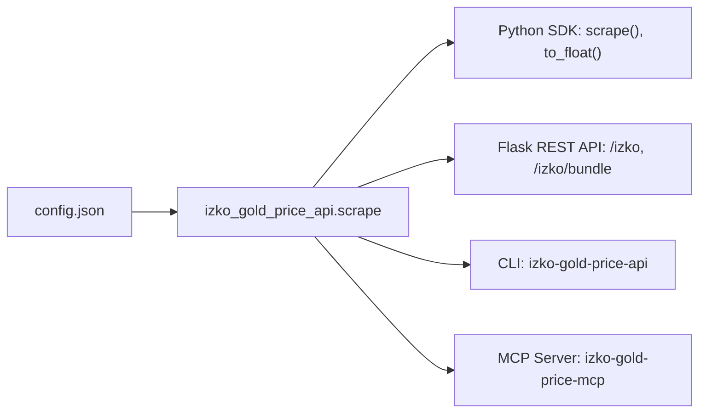

<!-- well-document · audit scorecard: G1:5 G2:5 G3:5 G4:5 G5:5 G6:5 · STATUS: PASS -->

[← Back to Root Repository](../README.md)

# izko-gold-price-api Documentation

Technical reference documentation for the `izko-gold-price-api` Python SDK, Flask REST service, CLI utility, and Model Context Protocol (`MCP`) server.

## Table of Contents

- [Documentation Index](#documentation-index)
- [Interface Overview](#interface-overview)
- [Source Modules](#source-modules)
- [Verification](#verification)

## Documentation Index

| Document | Scope |
| :--- | :--- |
| [architecture.md](architecture.md) | System topology, Playwright headless Chromium lifecycle, Turkish decimal normalization, and security boundaries. |
| [api-reference.md](api-reference.md) | Flask HTTP routes (`/izko`, `/izko/bundle`), Python SDK functions (`scrape`, `to_float`, `load_config`), and status codes. |
| [cli-and-mcp.md](cli-and-mcp.md) | Command-line subcommands (`serve`, `scrape`, `config`, `mcp`) and MCP JSON-RPC 2.0 `stdio` protocol specification. |
| [deployment.md](deployment.md) | Docker container builds, non-root `appuser` isolation, reverse-proxy rate limiting, and PyPI OIDC Trusted Publishing. |

## Interface Overview

`izko-gold-price-api` exposes four execution surfaces backed by a single scraping engine in [`scrape.py`](../src/izko_gold_price_api/scrape.py):



## Source Modules

| File | Responsibility |
| :--- | :--- |
| [`src/izko_gold_price_api/__init__.py`](../src/izko_gold_price_api/__init__.py) | Package exports and version identifier (`__version__`). |
| [`src/izko_gold_price_api/scrape.py`](../src/izko_gold_price_api/scrape.py) | Configuration loading, URL/timeout validation, Playwright DOM scraping, and `to_float()` conversion. |
| [`src/izko_gold_price_api/app.py`](../src/izko_gold_price_api/app.py) | Flask application factory and HTTP endpoint handlers. |
| [`src/izko_gold_price_api/cli.py`](../src/izko_gold_price_api/cli.py) | Standard library `argparse` command-line parser and subcommand dispatcher. |
| [`src/izko_gold_price_api/mcp.py`](../src/izko_gold_price_api/mcp.py) | Standard library JSON-RPC 2.0 `stdio` server implementing the Model Context Protocol. |
| [`src/izko_gold_price_api/config.json`](../src/izko_gold_price_api/config.json) | Default upstream URL, selector timeout, DOM ID mapping, and Flask bind settings. |

## Verification

Run the documentation link checker and Python bytecode compiler from the repository root:

```bash
make verify
```
