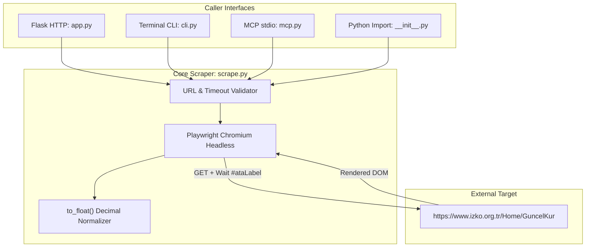
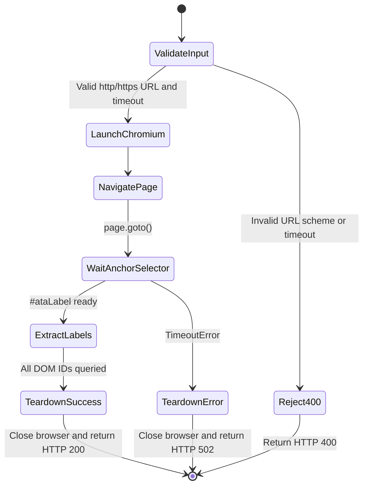

<!-- well-document · audit scorecard: G1:5 G2:5 G3:5 G4:5 G5:5 G6:5 · STATUS: PASS -->

[← Back to Root Repository](../README.md)

# System Architecture

This document specifies the internal data flow, DOM synchronization strategy, number parsing rules, and security boundaries of `izko-gold-price-api`.

## Table of Contents

- [Component Topology](#component-topology)
- [Playwright Scraping Lifecycle](#playwright-scraping-lifecycle)
- [Turkish Decimal Normalization](#turkish-decimal-normalization)
- [Configuration Resolution](#configuration-resolution)
- [Security Boundaries](#security-boundaries)

## Component Topology

All runtime interfaces delegate upstream data extraction to [`scrape.py`](../src/izko_gold_price_api/scrape.py). Neither the Flask server, the CLI, nor the MCP handler maintains separate HTTP or DOM parsing logic.

## Playwright Scraping Lifecycle

The target page `https://www.izko.org.tr/Home/GuncelKur` populates gold and currency prices dynamically in the browser DOM. A plain HTTP request without JavaScript execution returns unpopulated placeholder elements.

When `scrape()` is called:

1. **Input Guard**: `is_safe_http_url()` verifies that the target URL uses `http` or `https` and includes a network host. Wait timeout is checked against the `[100, 60000]` millisecond window.
2. **Browser Launch**: `sync_playwright()` starts a headless Chromium instance.
3. **Navigation and Readiness Anchor**: `page.goto()` navigates to the target URL and `page.wait_for_selector()` blocks until the Cumhuriyet gold selector (`#ataLabel` by default) is attached to the DOM.
4. **Element Iteration**: Each entry in the `label` map from [`config.json`](../src/izko_gold_price_api/config.json) is queried via `page.query_selector(f"#{id_}")`. If the element exists, its trimmed `inner_text()` is passed to `to_float()`. Missing selectors resolve to `None`.
5. **Deterministic Teardown**: `browser.close()` executes inside a `finally` block so browser processes never leak on selector timeouts or navigation failures.

## Turkish Decimal Normalization

Upstream DOM elements render prices using Turkish locale punctuation where `.` separates thousands and `,` separates decimals, such as `"23.450,75"`. Non-numeric fields such as `Tarih` (`#clock`) contain time strings like `"14:30:00"`.

`to_float(value: str) -> float | str` applies a two-stage conversion:

1. Strip all `.` characters and replace `,` with `.`.
2. Pass the normalized string to `float()`. If `ValueError` or `AttributeError` occurs, return the original string untouched.

| Raw DOM Text | Normalized Intermediate | Returned Value | Returned Type |
| :--- | :--- | :--- | :--- |
| `"23.450,75"` | `"23450.75"` | `23450.75` | `float` |
| `"3.180"` | `"3180"` | `3180.0` | `float` |
| `"34,25"` | `"34.25"` | `34.25` | `float` |
| `"14:30:00"` | `"14:30:00"` | `"14:30:00"` | `str` |

## Configuration Resolution

`load_config(config_path)` resolves configuration in the following precedence order:

1. Explicit `config_path` argument passed to `load_config()` or `--config` on the CLI.
2. Path specified in the `IZKO_CONFIG_PATH` environment variable.
3. Bundled [`src/izko_gold_price_api/config.json`](../src/izko_gold_price_api/config.json) located relative to `scrape.py`.

## Security Boundaries

| Boundary | Threat Mitigated | Control Implemented |
| :--- | :--- | :--- |
| `is_safe_http_url()` | Local file read via `file://` or script execution via `javascript:` URI in headless Chromium | Rejects any URL whose scheme is not `http` or `https` with HTTP `400`. |
| Timeout Bounds | Denial of service via unbounded browser wait times | Enforces `100 <= timeout <= 60000` milliseconds (`MIN_TIMEOUT_MS` to `MAX_TIMEOUT_MS`). |
| `try ... finally: browser.close()` | Host memory exhaustion from orphaned Chromium processes on navigation error | Guarantees browser termination before returning HTTP `502`. |
| `api.debug: false` | Werkzeug interactive debugger arbitrary code execution on network interfaces | Disabled by default in `config.json` and enforced via `--no-debug` in [`Dockerfile`](../Dockerfile). |
| Container `USER appuser` | Container root privilege escalation | Drops `root` after system package installation in [`Dockerfile`](../Dockerfile). |
