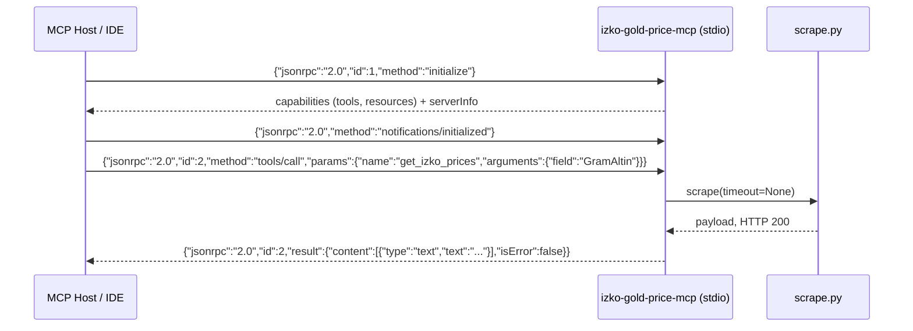

<!-- well-document · audit scorecard: G1:5 G2:5 G3:5 G4:5 G5:5 G6:5 · STATUS: PASS -->

[← Back to Root Repository](../README.md)

# Command-Line Interface and MCP Server Guide

Reference guide for the `izko-gold-price-api` CLI and the `izko-gold-price-mcp` Model Context Protocol (`MCP`) JSON-RPC 2.0 server.

## Table of Contents

- [CLI Entry Points](#cli-entry-points)
- [CLI Subcommands](#cli-subcommands)
- [MCP Server Architecture](#mcp-server-architecture)
- [MCP Client Configuration](#mcp-client-configuration)
- [MCP Tools and Resources](#mcp-tools-and-resources)

## CLI Entry Points

Installing the package registers two console scripts and a module entry point:

| Command | Entry Point | Purpose |
| :--- | :--- | :--- |
| `izko-gold-price-api` | `izko_gold_price_api.cli:main` | Full CLI with `serve`, `scrape`, `config`, and `mcp` subcommands. |
| `izko-gold-price-mcp` | `izko_gold_price_api.mcp:main` | Direct `stdio` MCP server entry point for AI assistants and IDEs. |
| `python -m izko_gold_price_api` | `izko_gold_price_api.__main__` | Module execution alias for `izko-gold-price-api`. |

## CLI Subcommands

### `serve` (Default)

Starts the Flask REST API server. Running `izko-gold-price-api` with no arguments defaults to `serve`.

```bash
# Default bind (127.0.0.1:5000, debug disabled)
izko-gold-price-api serve

# Custom bind address and port
izko-gold-price-api serve --host 0.0.0.0 --port 8080 --no-debug
```

### `scrape`

Runs a one-shot headless Chromium scrape from the terminal and prints the result to `stdout`.

```bash
# Compact single-line JSON output
izko-gold-price-api scrape

# Indented JSON output
izko-gold-price-api scrape --pretty

# Single field extraction for shell scripts
GRAM_PRICE=$(izko-gold-price-api scrape --field GramAltin)
echo "24K Gram Gold: $GRAM_PRICE TRY"
```

### `config`

Prints the active configuration JSON and exits with status `0`.

```bash
izko-gold-price-api config
izko-gold-price-api --config /path/to/custom-config.json config
```

### `mcp`

Starts the JSON-RPC 2.0 Model Context Protocol server over standard input and standard output (`stdio`).

```bash
izko-gold-price-api mcp
```

## MCP Server Architecture

[`mcp.py`](../src/izko_gold_price_api/mcp.py) implements the Model Context Protocol over newline-delimited JSON-RPC 2.0 using only the Python standard library (`json`, `sys.stdin`, `sys.stdout`).



## MCP Client Configuration

Add the server to Claude Desktop, Cursor, or Antigravity MCP settings:

```json
{
  "mcpServers": {
    "izko-gold-price": {
      "command": "izko-gold-price-mcp",
      "env": {
        "IZKO_CONFIG_PATH": "/optional/path/to/config.json"
      }
    }
  }
}
```

## MCP Tools and Resources

### Tools (`tools/list`, `tools/call`)

| Tool Name | Input Arguments | Output |
| :--- | :--- | :--- |
| `get_izko_prices` | `field` (`string`, optional), `timeout` (`integer`, `100` to `60000`, optional) | Full `priceList` JSON or a single `{field, value, url}` JSON object when `field` is specified. |
| `get_izko_config` | None | Active configuration JSON from `load_config()`. |

### Resources (`resources/list`, `resources/read`)

| Resource URI | MIME Type | Content |
| :--- | :--- | :--- |
| `izko://config` | `application/json` | Active configuration JSON document. |
| `izko://prices` | `application/json` | Live scraped gold and currency price bundle. |
