<!-- well-document · audit scorecard: G1:5 G2:5 G3:5 G4:5 G5:5 G6:5 · STATUS: PASS -->

[← Back to Root Repository](../README.md)

# Deployment and Release Pipeline

Operational guide for running `izko-gold-price-api` in Docker containers and publishing new versions to PyPI via Release Please and OpenID Connect (`OIDC`) Trusted Publishing.

## Table of Contents

- [Docker Container Deployment](#docker-container-deployment)
- [Container Security Model](#container-security-model)
- [Automated Release Pipeline](#automated-release-pipeline)
- [PyPI Trusted Publisher Configuration](#pypi-trusted-publisher-configuration)

## Docker Container Deployment

[`Dockerfile`](../Dockerfile) packages the Python package, headless Chromium binary, and required Debian shared libraries into a single container image.

```bash
# Build the container image
make docker-build

# Run the container in the background on port 5000
make docker-run

# Verify the running container
curl -f http://localhost:5000/izko
```

To override [`config.json`](../src/izko_gold_price_api/config.json) at runtime without rebuilding the image, mount a custom JSON file and set `IZKO_CONFIG_PATH`:

```bash
docker run -d \
  -p 5000:5000 \
  -v "$(pwd)/custom-config.json:/app/custom-config.json:ro" \
  -e IZKO_CONFIG_PATH=/app/custom-config.json \
  --name izko-api \
  izko-gold-price-api
```

## Container Security Model

1. **Privilege Drop**: [`Dockerfile`](../Dockerfile) installs system packages and Playwright shared libraries as `root`, creates an unprivileged `appuser` account, and switches to `USER appuser` before installing the Chromium binary and starting the server.
2. **Debug Disabled**: The container entrypoint runs `izko-gold-price-api serve --host 0.0.0.0 --port 5000 --no-debug`.
3. **Build Context Isolation**: [`.dockerignore`](../.dockerignore) strips `.git`, `.github`, virtual environments, and local `.env` files from the Docker build context.

## Automated Release Pipeline

Releases are automated by [`.github/workflows/release-please.yml`](../.github/workflows/release-please.yml) and configured in [`release-please-config.json`](../release-please-config.json).

```mermaid
flowchart LR
    Push["Push Conventional Commit to main"] --> RP["Job 1: release-please"]
    RP -->|"Updates open PR"| PR["chore(release): release X.Y.Z"]
    PR -->|"Maintainer merges PR"| Tag["GitHub Release & Tag vX.Y.Z"]
    Tag --> Build["Job 2: build-release-artifacts"]
    Build -->|"gh release upload + artifact"| Publish["Job 3: publish-pypi (OIDC)"]
    Publish --> PyPI["pypi.org/p/izko-gold-price-api"]
```



When a release pull request is merged into `main`:

1. **Version Synchronization**: Release Please updates the version in [`pyproject.toml`](../pyproject.toml), [`src/izko_gold_price_api/__init__.py`](../src/izko_gold_price_api/__init__.py), [`src/izko_gold_price_api/cli.py`](../src/izko_gold_price_api/cli.py), [`src/izko_gold_price_api/mcp.py`](../src/izko_gold_price_api/mcp.py), and [`.release-please-manifest.json`](../.release-please-manifest.json), and prepends release notes to [`CHANGELOG.md`](../CHANGELOG.md).
2. **Artifact Build**: `build-release-artifacts` checks out the new tag, builds `sdist` and `bdist_wheel` packages with `python -m build`, validates metadata with `twine check`, attaches the files to the GitHub Release, and uploads the `pypi-dist` workflow artifact.
3. **PyPI Upload**: `publish-pypi` downloads `pypi-dist` inside the `pypi` environment and publishes to PyPI using `pypa/gh-action-pypi-publish@release/v1`.

## PyPI Trusted Publisher Configuration

Configure the repository on `https://pypi.org/manage/account/publishing/` with these exact coordinates:

| Setting | Value |
| :--- | :--- |
| **PyPI Project Name** | `izko-gold-price-api` |
| **Owner** | `AtaCanYmc` |
| **Repository name** | `izko-gold-price-api` |
| **Workflow name** | `release-please.yml` |
| **Environment name** | `pypi` |
